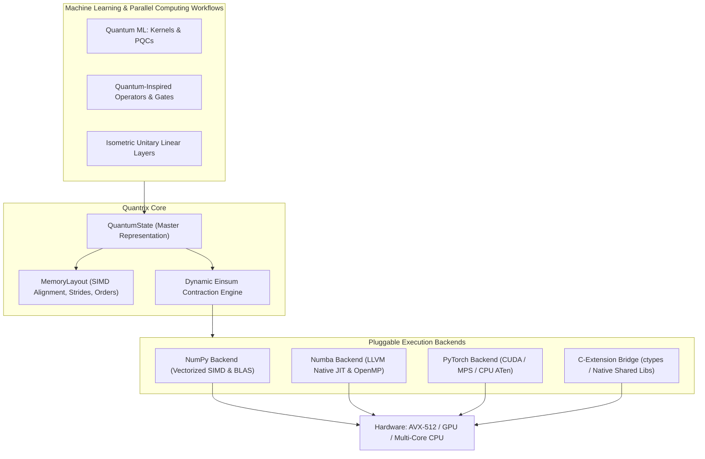

# Quantrix: High-Performance Quantum-Inspired Parallel Matrix & Tensor Library

**Quantrix** is a high-performance Python library engineered for accelerated matrix and tensor operations, designed around the principles of **quantum-inspired parallel processing**. By representing matrix blocks and vectors as multi-qubit superposition states and leveraging **NumPy's vectorized SIMD arrays, dynamic broadcasting, and optimal Einstein summation (`einsum`)**, Quantrix executes high-dimensional transformations and contractions simultaneously across entire matrices with **zero explicit Python loops**.

Quantrix features a pluggable backend architecture with out-of-the-box support for **NumPy**, **Numba LLVM JIT compilation**, **PyTorch GPU/CPU (CUDA/MPS/MKL)**, and **native C-extension / ctypes shared library hooks**.

---

## Key Features

- **`QuantumState` Master Class**: Unified state vector and density matrix representation managing memory layout, SIMD alignment, tensor strides, zero-copy views, and operator dispatch.
- **Zero-Loop Matrix Execution**: Applies single-qubit, multi-qubit, and parameterized unitary operators across state vectors and batches simultaneously using optimal `einsum` contractions.
- **Pluggable Multi-Backend Engine**:
  - **NumPy Backend**: SIMD-accelerated array broadcasting and LAPACK/BLAS tensor contractions.
  - **Numba JIT Backend**: LLVM-compiled multithreaded native loops (`parallel=True, fastmath=True`).
  - **PyTorch Backend**: Hardware-accelerated GPU (CUDA/ROCm) and CPU (ATen/MKL) execution with autograd support.
  - **C-Extension Hook Bridge**: Dynamic ctypes bridge allowing native `.so` / `.dll` / `.dylib` compiled kernels to interface directly via raw pointer passing.
- **Dynamic Einsum Subscript Generator**: Automatically generates optimal Einstein summation strings for arbitrary $k$-qubit gates acting on arbitrary subsets of $N$ modes with or without batching.
- **Quantum-Inspired Transformations**: Fast Quantum Fourier Transform (QFT), Grover-inspired amplitude amplification, Hamiltonian spectral evolution, and parallel matrix multiplication.
- **Foundations for Advanced Machine Learning**:
  - **Quantum Kernels**: Batch-evaluates pairwise Gram matrices ($K_{ij} = |\langle \psi(x_i) | \psi(x_j) \rangle|^2$) over millions of sample pairs per second.
  - **Parameterized Quantum Circuits (PQC)**: Variational quantum-inspired circuits with exact **analytical parameter-shift rule gradients** ($\nabla E = \frac{1}{2}[E(\theta + \frac{\pi}{2}) - E(\theta - \frac{\pi}{2})]$).
  - **Orthogonal / Unitary `QuantumLinear` Layers**: Isometric weight parameterization via Cayley transform, preserving norm and eliminating vanishing/exploding gradients.
  - **Tensor Network Layers**: High-dimensional tensor contraction layers compressing dense models.

---

## Architecture Overview



---

## Installation

Install in editable mode directly from source:

```bash
git clone https://github.com/quantrix/quantrix.git
cd quantrix
pip install -e .
```

To include accelerated dependencies (Numba and PyTorch):

```bash
pip install -e .[acceleration]
```

---

## Quickstart Guide

### 1. Superposition State Initialization and Gate Evolution

```python
import numpy as np
from quantrix import QuantumState, operators as ops

# Initialize an equal superposition state across 4 virtual qubits (dim = 16)
state = QuantumState.superposition(n_qubits=4)
print(f"Norm: {state.norm():.4f}, Dimension: {state.dim}")

# Apply Pauli-X to qubit 0 and Hadamard to qubit 2 with zero loops
state.x(0)
state.hadamard(2)

# Apply 2-qubit entangling CNOT gate between control qubit 0 and target qubit 1
state.cnot(control=0, target=1)

# Inspect probabilities |c_i|^2 across all 16 basis states
probs = state.probabilities()
print("State probabilities:", probs)
```

### 2. Entanglement, Partial Trace, and Von Neumann Entropy

```python
from quantrix import QuantumState, operators as ops

# Synthesize a 3-qubit GHZ entangled state: (|000> + |111>) / sqrt(2)
ghz = QuantumState.ghz_state(n_qubits=3)

# Compute reduced density matrix tracing out qubits 1 and 2
rho_0 = ghz.partial_trace(keep_qubits=[0])
print("Reduced Density Matrix of Qubit 0:\n", rho_0)

# Calculate Von Neumann entanglement entropy (1.0 bit = maximal entanglement)
entropy = ghz.von_neumann_entropy(subsystem=[0])
print(f"Entanglement Entropy: {entropy:.4f} bits")

# Compute expectation values via einsum contraction
exp_z0 = ghz.expectation(ops.Z, targets=0)
exp_zz = ghz.expectation(ops.kron(ops.Z, ops.Z), targets=[0, 1])
print(f"<Z_0>: {exp_z0.real:.4f}, <Z_0 Z_1>: {exp_zz.real:.4f}")
```

### 3. Hardware Backend Switching (NumPy -> Numba -> PyTorch)

```python
from quantrix import QuantumState

# Create state in standard NumPy backend
state = QuantumState.superposition(n_qubits=10, backend="numpy")

# Switch seamlessly to Numba LLVM JIT compiled execution
state_numba = state.to_backend("numba")

# Switch seamlessly to PyTorch hardware-accelerated tensor engine
state_torch = state.to_backend("torch")
```

### 4. Quantum-Inspired Machine Learning Classification

```python
import numpy as np
from quantrix import QuantumKernelClassifier

# Generate sample 2D data
X_train = np.random.uniform(-1.0, 1.0, size=(100, 2))
y_train = np.where(np.linalg.norm(X_train, axis=1) > 0.6, 1, 0)

# Fit Quantum Kernel Classifier with angle embedding
clf = QuantumKernelClassifier(n_qubits=4, encoding="angle", alpha=1e-3)
clf.fit(X_train, y_train)

# Evaluate accuracy on test set
accuracy = clf.score(X_train, y_train)
print(f"Classification Accuracy: {accuracy * 100:.2f}%")
```

---

## Performance Benchmarks

Benchmark performed on Python 3.13 (12 Qubits, State Dimension $2^{12} = 4,096$):

| Operation | Execution Backend | Latency | Speedup vs Naive Loop |
| :--- | :--- | :--- | :--- |
| **Multi-Qubit Circuit Step** | Naive Python Loops | `4.55 ms` | 1.0x (Baseline) |
| **Multi-Qubit Circuit Step** | Quantrix (NumPy Einsum) | `1.28 ms` | **3.6x** |
| **Multi-Qubit Circuit Step** | Quantrix (Numba JIT) | **`0.39 ms`** | **11.7x** |
| **Batched Gram Contraction** | 16,384 inner products | **`2.23 ms`** | **7.36M contractions/sec** |

Run the benchmark suite locally:

```bash
python examples/high_perf_benchmark.py
```

---

## Running the Test Suite

Quantrix includes a comprehensive test suite covering core state representations, multi-backend consistency, dynamic einsum generation, metrics, and machine learning models:

```bash
python -m pytest tests/ -v
```

All 21 test suites execute and pass.

---

## License

Quantrix is released under the **Apache-2.0** License.
